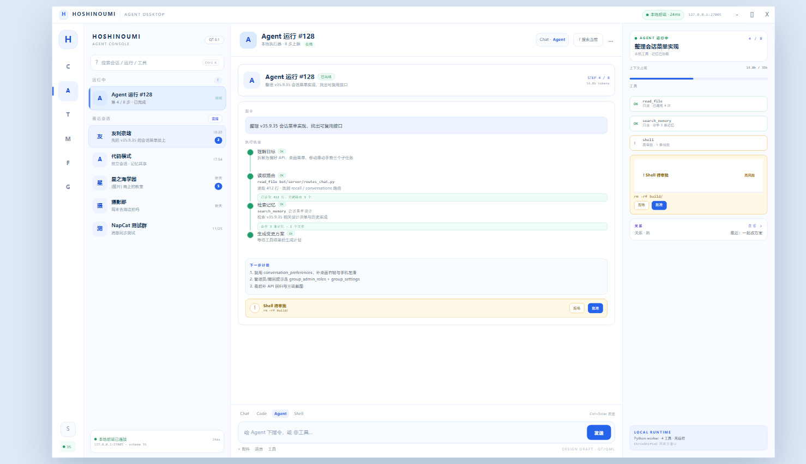
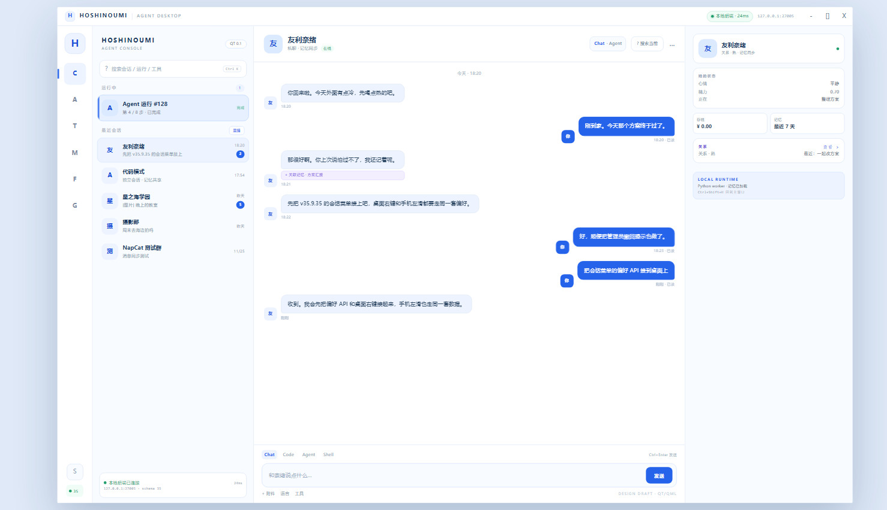
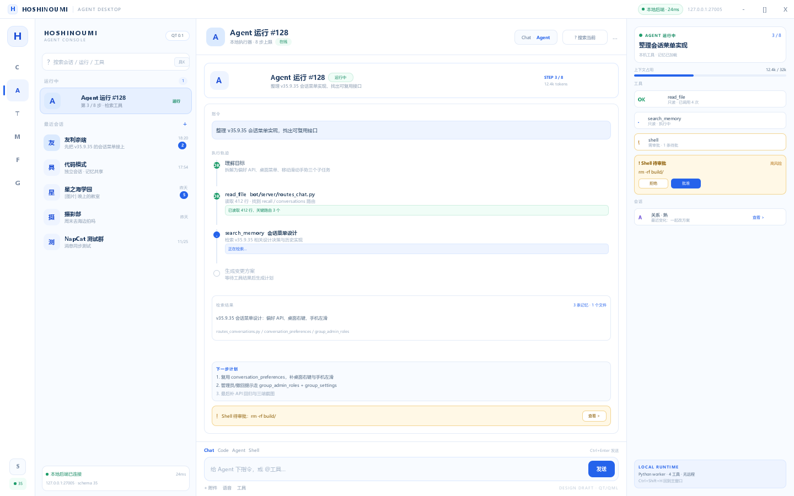
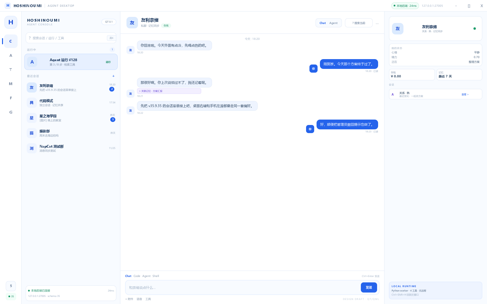

# Hoshinoumi Qt / QML 桌面设计稿 v1

参考 `docs/design/v35/web/hoshinoumi-web-v35.5.html` 的浅色三栏语言，重做为 Qt 原生桌面稿。

## HTML 动效预览

直接双击打开：

```text
docs/design/qt/v1/preview.html
```

这是可交互的 HTML 模拟稿，不是静态截图：

```text
Chat / Agent 模式切换
Agent 执行时间线自动播放
工具结果逐条出现
Shell 审批 批准/拒绝
重播 Agent 运行
聊天输入 + 输入中 + 模拟回复
窗口按屏幕大小自动缩放
```


```text
1440 x 900
标题栏 34
左侧导航 64
会话列表 292
聊天主区 780
右侧上下文 304
```





QML 渲染稿：





## 设计定位

不是把 Web 页面塞进 QWebEngine，而是按 Qt/QML 原生控件重排：

```text
QML Rectangle / Layout / Text / Loader
Qt Quick Controls 作为行为控件
后续接 QAbstractListModel / QAbstractItemModel
```

## 视觉

```text
背景          #f2f7fd
面板          #ffffff / #f8fbff
主文字        #1e3a5f / #314a65
弱文字        #8a9bb0 / #a2b2c6
主蓝          #2563eb
浅蓝底        #eef4ff / #dbeafe
成功          #1f9d6b
警告          #b7791f / #fff8e6
错误          #b91c1c / #fff5f5
边框          #e3ebf7 / #dbe8ff
圆角          7 / 9 / 10 / 12
```

字体：

```text
Microsoft YaHei UI
Consolas（代码 / 数字）
```

## 结构

### 标题栏

```text
HOSHINOUMI · AGENT DESKTOP
本地后端 · 24ms
127.0.0.1:27005
最小化 / 最大化 / 关闭
```

### 左侧导航

```text
H logo
C  会话
A  Agent
T  任务
M  记忆
F  文件
G  工具
S  设置
schema 35 状态
```

激活项使用浅蓝底 + 左侧 3px 蓝条。

### 会话列表

```text
品牌 / QT 0.1
搜索
运行中
  Agent 运行 #128
最近会话
  友利奈绪 / 代码模式 / 星之海学园 / 摄影部 / NapCat 测试群
底部本地后端状态
```

运行中会话使用浅蓝选中卡片；未读使用蓝色数字；免打扰后续显示在行尾。

### 聊天主区

```text
头部：头像 / 名称 / 在线 / 模式胶囊 / 搜索 / 更多
消息：日期 / 头像 / 气泡 / 记忆 chip / 时间 / 已读
底部：Chat / Code / Agent / Shell + 输入框 + 发送
```

外发消息头像在气泡左侧，整组右对齐，与 Web 设计稿一致。

### Agent 运行视图

```text
运行摘要
  #128 / 运行中 / STEP 3/8 / 12.4k tokens
指令
执行轨迹
  理解目标            done
  read_file           done + 工具结果
  search_memory       running + 结果占位
  生成变更方案         pending
下一步计划
Shell 待审批
```

执行轨迹使用时间线 + 工具结果条；不把工具调用伪装成普通聊天气泡。

### 右侧上下文

Chat：

```text
人设卡
她的状态（心情 / 精力 / 正在）
关系
存钱 / 记忆快捷
本地 runtime
```

Agent：

```text
Agent 运行中
上下文占用
工具列表（read_file / search_memory / shell）
Shell 待审批
关系
本地 runtime
```

## QML 文件

```text
Main.qml
components/TitleBar.qml
components/NavRail.qml
components/ConversationPane.qml
components/ChatPane.qml
components/AgentRunPane.qml
components/ContextPane.qml
render.py
```

`Main.qml` 通过 `agentMode` 切换 Chat / Agent 两种状态。

## 渲染

```text
.venv\Scripts\python.exe docs/design/qt/v1/render.py agent docs/design/qt/v1/shots/agent.png
.venv\Scripts\python.exe docs/design/qt/v1/render.py chat  docs/design/qt/v1/shots/chat.png
```

依赖 PySide6；脚本会加载系统 Microsoft YaHei / Segoe UI 字体。

## 落成 Qt 应用时

```text
QMainWindow
  QQuickWidget / QQuickView
    Main.qml
```

数据层建议：

```text
ConversationModel : QAbstractListModel
MessageModel      : QAbstractListModel
ToolRunModel      : QAbstractListModel
AgentRunModel     : QAbstractListModel
```

交互信号：

```text
selectConversation(targetId)
sendMessage(text)
switchMode(mode)
approveTool(callId, approved)
cancelRun(runId)
```

不要把这些状态继续塞进全局单例；Qt 侧应通过 model + signal 驱动，和现有后端 `/api/conversations`、`/api/chat`、`/api/chat/mode` 对齐。

## 状态与边界

```text
这是设计稿，不是已编译的 Qt 应用
数据为展示用示例
窗口尺寸针对 1440 x 900
小于 1180 应切到两栏 / 隐藏右侧上下文
小于 820 交给手机客户端，不复用桌面三栏
```
